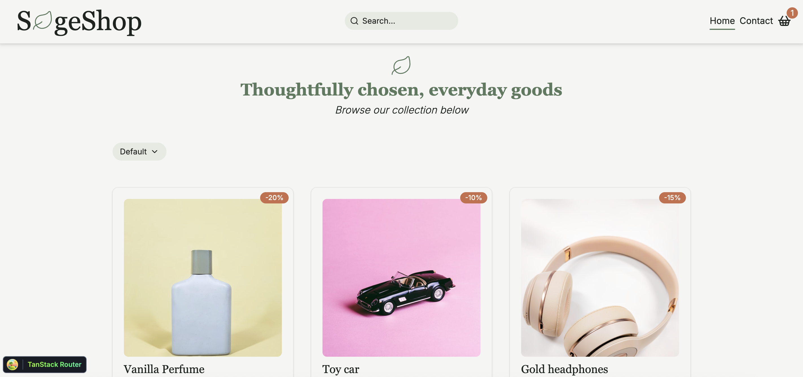
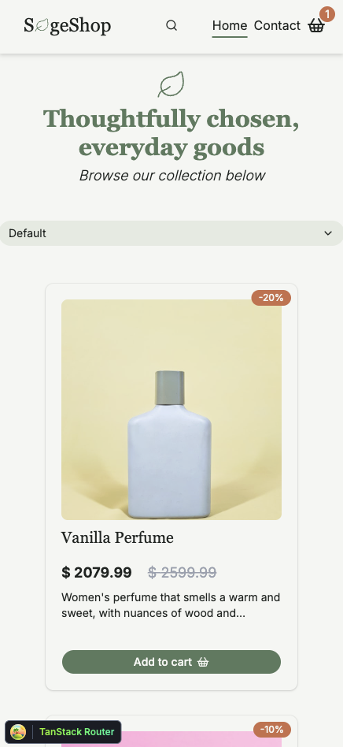
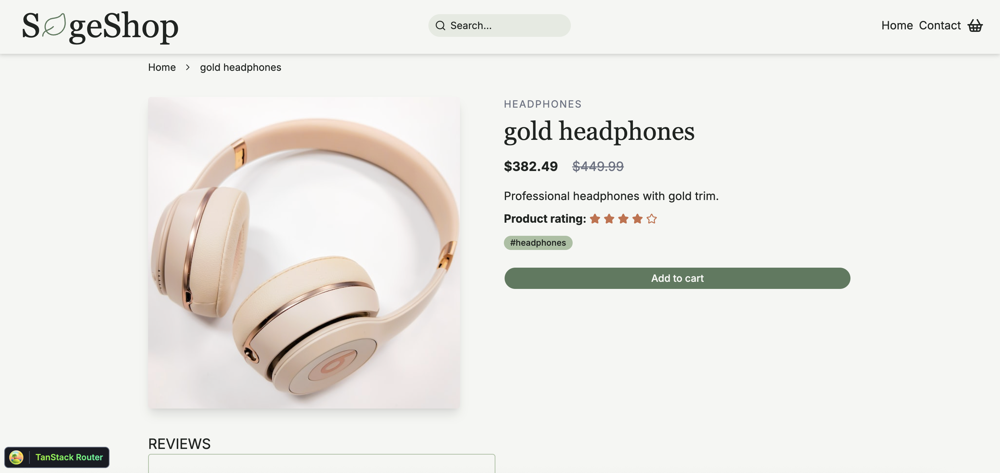
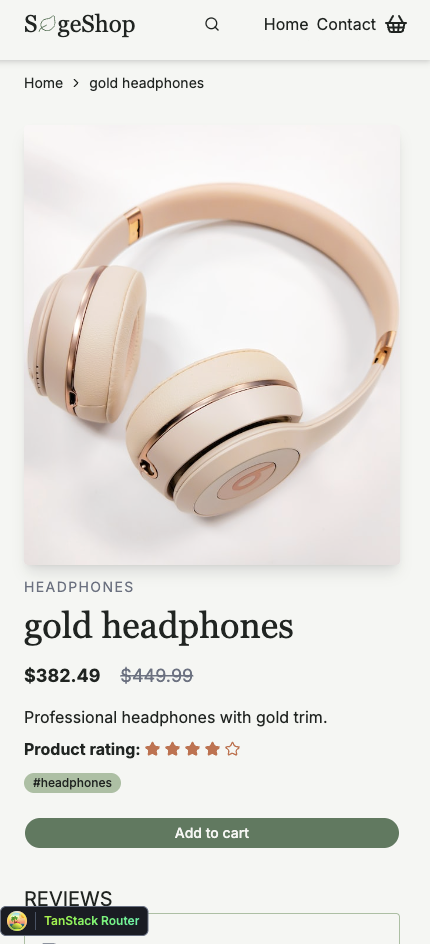
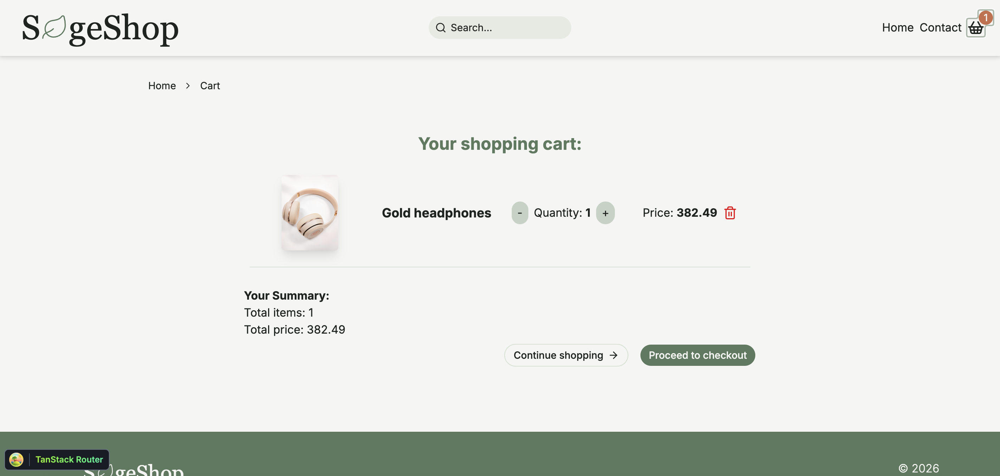
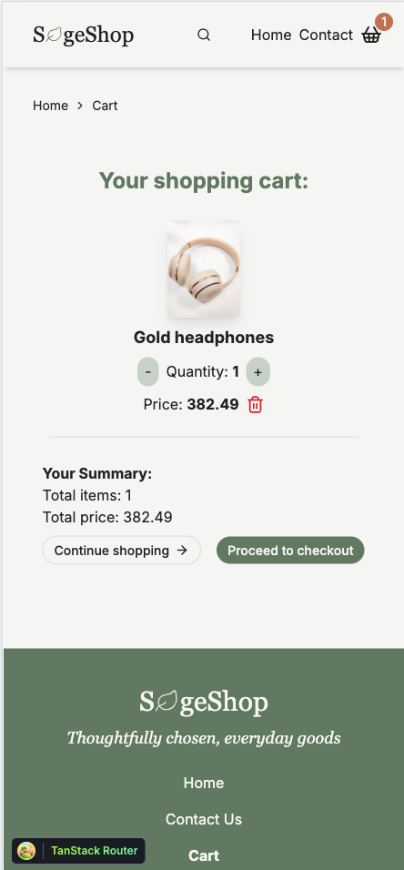

# SageShop



## Intro

SageShop is an online shop where users can browse products, search through the different products, and sort by price or rating.

Users can also view a product, and see reviews that other buyers have left on the product. The user can also add products to a shopping cart and go through checkout.

The shopping cart allows the user to either increase or decrease the quantity of a product or delete a product. It includes buttons to either shop more or continue to checkout.

The checkout process shows a successful "purchase" and the option to continue shopping.

SageShop is my assignment for the course JavaScript Frameworks and is a part of my studies to become a front-end developer.

#### Live Demo: [SageShop][sageshop]

[//]: # 'Source definitions'
[sageshop]: https://sageshop.netlify.app/ 'SageShop'

## Feature overview

- [x] Browse products
- [x] Sorting by options
- [x] Search products
- [x] Search bar in header
- [x] Adding products to cart
- [x] Change quantity in cart
- [x] Delete products from cart
- [x] Successfully go through checkout
- [x] See product and reviews of the product
- [x] Contact form with form validation
- [x] Breadcrumb on pages
- [x] Responsive design for all devices

## Contents

- [Getting started](#getting-started)
  - [Requirements](#requirements)
  - [Install](#install)
  - [Usage](#usage)
- [Used Technologies](#used-technologies)
  - [Technical Choices](#technical-choices)
  - [API](#api)
- [Images](#images-and-project-structure)
- [Contributing](#contributing)
  - [Testing](#testing)
- [Further Improvements](#further-improvements)
- [Author](#author)

## Getting Started

In order to run this project locally on your computer, you have to do the following steps.
It is easier than you think.

### Requirements

Make sure that you have the following installed on your computer:

- Node.js (version 20.19 or higher)
- npm
- Git

### Install

#### 1. Clone the repository:

Use git to clone this repository into your computer. Assuming using https, then run the following in your CLI:

```
git clone https://github.com/Kateve52911/sageshop.git
```

#### 2. Install dependencies:

Navigate to the root directory of the repo and run the following to install all dependencies.

```
npm install
```

### Usage

To run the development server:

```bash
npm run dev
```

Open your browser and navigate to the local host address shown in the terminal.

To build the project for production:

```bash
npm run build
```

And then run the following command to view it:

```
npm run preview
```

Open your browser and navigate to the local host address shown in the terminal.

## Used technologies

The tech stack for this project includes:

- React
- TypeScript
- Tailwind CSS
  - Shadcn/ui
  - Lucide Icons
- TanStack Router
- TanStack Query
- Zustand
- React Hook Form
- Zod
- Vite
- Vitest
- Husky
- ESLint
- Prettier
- Lint-staged

### Technical choices

**TanStack Query:** caches the products, so going back to the homepage doesn’t fetch them again.

**Zustand with persist:** keeps the cart in localStorage, so it survives a page refresh.

**Search in URL:** it is shareable and it survives a refresh

**Filter → sort → paginate:** the product list goes through three steps, in this order:

1. **Filter:** only products that match the search
2. **Sort:** by the chosen sort option
3. **Paginate:** only the products for the current page

The order matters: if the list was paginated before sorting, "lowest price"
would only sort the 9 products on the current page, not all of them.

### API

Product data comes from the [Noroff Online Shop API](https://docs.noroff.dev/docs/v2/basic/online-shop). No API key is needed.

| Endpoint                | Used for                             |
| ----------------------- | ------------------------------------ |
| `GET /online-shop`      | All products on the homepage         |
| `GET /online-shop/<id>` | A single product on the product page |

All API code is in `src/services/api/`. Every request goes through `fetchHelper`,
which handles errors in one place and throws an `APIError` with the status code.

## Images and Project structure

### Images

The index page on a computer:


The index page on a mobile:


Product page on desktop:


Product page on mobile:


Cart on desktop:


Cart on mobile:


## Contributing

To contribute to the project, simply install as detailed above, and then after finishing your changes, create a PR on GitHub.

### Testing

This project includes unit tests to test the sorting, form validation and the cart store.

To run tests and to keep watch for changes, run the following command:

```
npm test
```

To run all tests once, run the following command:

```
npm run test:run
```

## Further Improvements

The following features I wish to add at a later date:

- [ ] Cart drawer
- [ ] Category Pills

## Author

Kathrine Mellem Evensen

[My portfolio website](https://kathrine-dev.vercel.app)

[My Github Profile](https://github.com/Kateve52911)

[My LinkedIn page](https://www.linkedin.com/in/kathrine-mellem-evensen-6855b612b)
