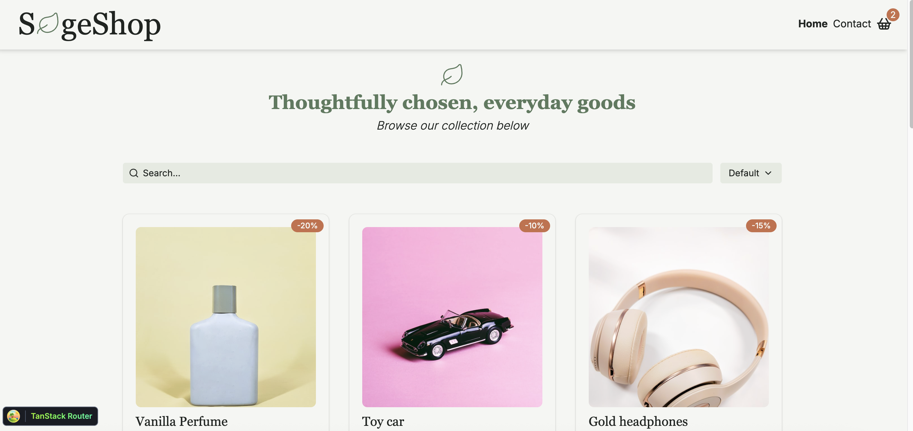

# Bidly Auction Site



## Intro

SageShop is an online shop where users can browse products, search through the different products, and filter by price or rating.

Users can also view a product, and see reviews that other buyers have left on the product. The user can also add products to a shopping cart and go through checkout.

The shopping cart allows the user to either increase or decrease the quantity of a product or delete a product. It includes buttons to either shop more or continue to checkout.

The checkout process shows a successful "purchase" and the option to continue shopping.

SageShop is my assignment for the course Javascript Frameworks and is a part of my studies to become a front-end developer.

#### Live Demo:

[SageShop][sageshop]

[//]: # 'Source definitions'
[sageshop]: https://sageshop.netlify.app/ 'SageShop'

## Feature overview

- [x] Browse products
- [x] Filter by options
- [X] Search products
- [x] Adding products to cart
- [X] Change quantity in cart
- [X] Delete products from cart
- [x] Successfully go through checkout
- [x] See product and reviews of the product
- [X] Contact form with form validation 
- [x] Responsive design for all devices

## Contents

- [Getting started](#getting-started)
  - [Requirements](#requirements)
  - [Install](#install)
  - [Usage](#usage)
- [Used Technologies](#used-technologies)
  - [API](#Api)
- [Images and Project Structure](#images-and-project-structure)
  - [Project Structure](#project-structure)
- [Contributing](#contributing)
  - [Testing](#testing)

## Getting Started

In order to run this project locally on you computer, you have to do the following steps.
It is easier than you think.

### Requirements

Make sure that you have the following installed on your computer:

- Node.js (version 18 or higher)
- npm or yarn
- Git

### Install

#### 1. Clone the repository:

Use git to clone this repository into your computer. Assuming using https, then run the following in your CLI:

```
git clone https://github.com/Kateve52911/sageshop.git
```

#### 2. Install dependencies:

Navigate to the root directory of the repo and run the following to install all dependencies.

```
npm install
```

### Usage

After installation, run the development server:

```bash
npm run dev
```

Open your browser and navigate to the local host address shown in the terminal.

After installation, run the build server:

```bash
npm run build
```

Open your browser and navigate to the local host address shown in the terminal.


## Used technologies

The tech stack for this project includes:

- React
- Typescript
- Tailwind
- Shadcn/ui
- TanStack Router
- TanStack Query
- Zustand
- React Hook Form
- Zod
- Vite
- Vitest
- Husky
- ESLint
- PlayWright

### API

Product data comes from the [Noroff Online Shop API](https://docs.noroff.dev/docs/v2/basic/online-shop). No API key is needed.

| Endpoint                | Used for                             |
|-------------------------|--------------------------------------|
| `GET /online-shop`      | All products on the homepage         |
| `GET /online-shop/<id>` | A single product on the product page |

All API code is in `src/services/api/`. Every request goes through `fetchHelper`,
which handles errors in one place and throws an `APIError` with the status code.


## Images and Project structure:

### Images

The index page:


The index page:


### Project structure:

## Project structure

```
sageshop/
├── public/
│   ├── _redirects              # Netlify: serve index.html on every path (SPA routing)
│   └── images/                 # Favicons and README screenshots
├── src/
│   ├── components/
│   │   ├── cart/               # CartItemRow, CartLink (cart icon with item count)
│   │   ├── common/             # ErrorMessage, LoadingSpinner
│   │   ├── layout/             # Header, Footer
│   │   ├── product/            # ProductCard, StarRating
│   │   └── ui/                 # shadcn/ui components
│   ├── lib/
│   │   └── utils.ts            # cn() helper for class names
│   ├── routes/                 # File-based routing (TanStack Router)
│   │   ├── __root.tsx          # Root layout: header, footer, page titles
│   │   ├── index.tsx           # Homepage: hero, search, sort, product list
│   │   ├── -components/        # Homepage-only components (Hero, ProductList, SearchBar, SortSelector, PaginationControls)
│   │   ├── products/
│   │   │   ├── $productId.tsx  # Product detail page
│   │   │   └── -components/    # ProductDetail
│   │   ├── cart/
│   │   │   ├── index.tsx       # Cart page
│   │   │   └── success.tsx     # Checkout success page (clears the cart)
│   │   └── contact/
│   │       └── index.tsx       # Contact form
│   ├── schemas/
│   │   └── contactSchema.ts    # Zod validation for the contact form
│   ├── services/api/           # API fetch functions, fetchHelper and APIError
│   ├── stores/
│   │   └── cartStore.ts        # Zustand cart store (saved to localStorage)
│   ├── types/                  # Product and CartItem types
│   ├── index.css               # Tailwind and theme variables
│   └── main.tsx                # App entry: router and TanStack Query setup
├── components.json             # shadcn/ui config
├── eslint.config.js
├── .prettierrc
└── vite.config.ts
```

## Contributing

To contribute to the project, simply install as detailed above, and then after finishing your changes, create a PR on GitHub.


### Testing

In this project, there are two kinds of tests: unit tests and end-to-end (e2e) tests. To run each of these respectively, run the following commands:

```
npm test
npx playwright test --headed
```

There are actually many ways to run the playwright (e2e) tests. For example:

```
npx playwright test tests/e2e/auth/login.spec.ts --headed  # run a single test
npx playwright test --last-failed  # run last failed tests
```
